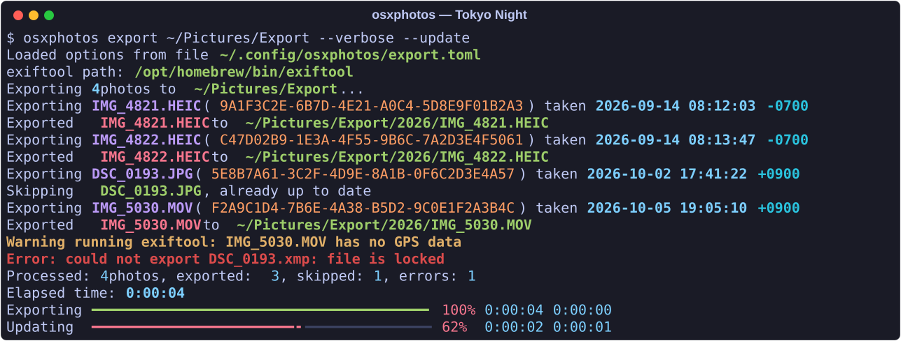
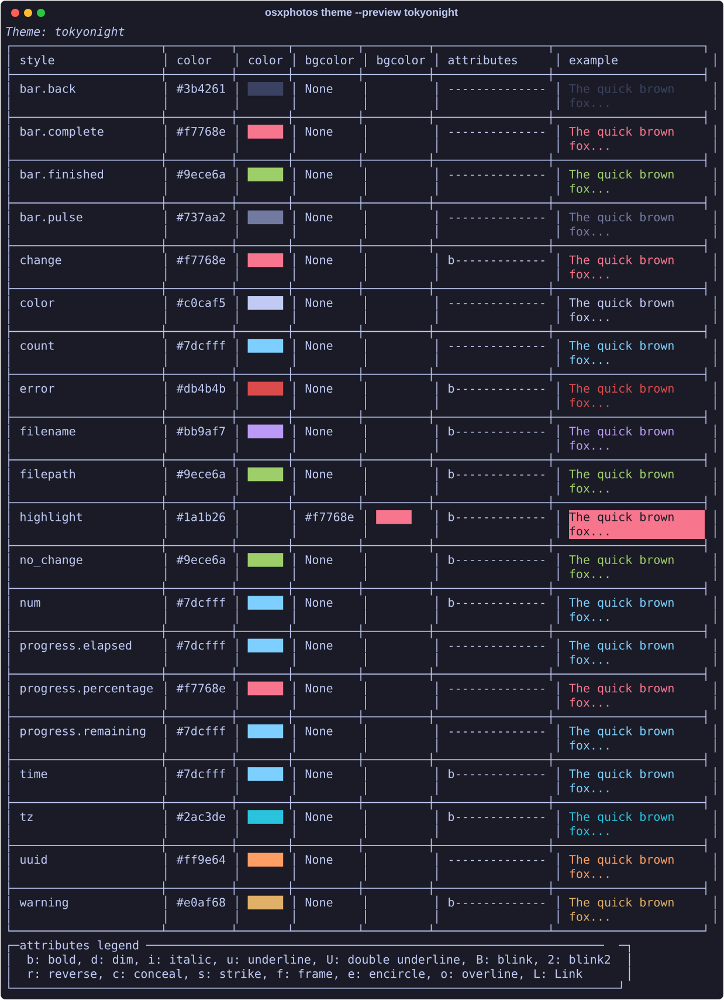

# Tokyo Night for osxphotos

A Tokyo Night color theme for [osxphotos](https://github.com/RhetTbull/osxphotos), made to match the [Tokyo Night iTerm2 theme](https://github.com/rojadesign/iTerm2-Tokyo-Night-Color-Theme).

osxphotos is an amazing command-line tool for backing up your Apple Photos library. It exports your photos and videos with their metadata (albums, keywords, people, places), so your library isn't locked inside Apple's app.



## Palette



## Installation

osxphotos loads custom themes from `~/.config/osxphotos/themes/`.

1. Download the theme into that directory:

   ```sh
   mkdir -p ~/.config/osxphotos/themes
   curl -fsSL -o ~/.config/osxphotos/themes/tokyonight.theme \
     https://raw.githubusercontent.com/timcheadle/osxphotos-tokyo-night/main/tokyonight.theme
   ```

   Or clone this repo and copy `tokyonight.theme` there yourself.

2. Check that osxphotos sees it:

   ```sh
   osxphotos theme --list
   osxphotos theme --preview tokyonight
   ```

## Making it the default

The `--theme` option on osxphotos commands only accepts the built-in themes (`dark`, `light`, `mono`, `plain`). Instead, osxphotos uses a theme named `default` whenever one exists, so clone Tokyo Night under that name:

```sh
osxphotos theme --clone tokyonight default
```

Confirm with:

```sh
osxphotos theme --default
```

To go back to the automatic dark/light behavior, delete the clone:

```sh
osxphotos theme --delete default
```

## Using it in a saved export config

If you run `osxphotos export --load-config`, you can set the theme in your `.toml` config file instead:

```toml
[export]
theme = "tokyonight"
```

## Credits

- **Colors:** adapted from [iTerm2 Tokyo Night Color Theme](https://github.com/rojadesign/iTerm2-Tokyo-Night-Color-Theme) by [rojadesign](https://github.com/rojadesign), itself based on the original [Tokyo Night](https://github.com/enkia/tokyo-night-vscode-theme) theme by [enkia](https://github.com/enkia).
- **osxphotos:** written and maintained by [Rhet Turnbull](https://github.com/RhetTbull). Thanks for a great tool, and for building in theme support.

## License

[MIT](LICENSE)
